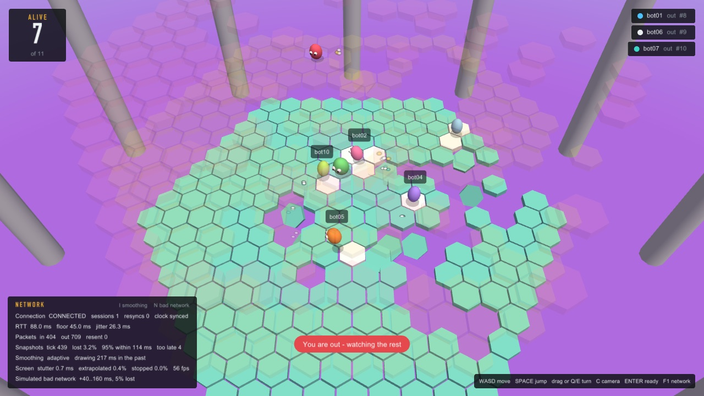
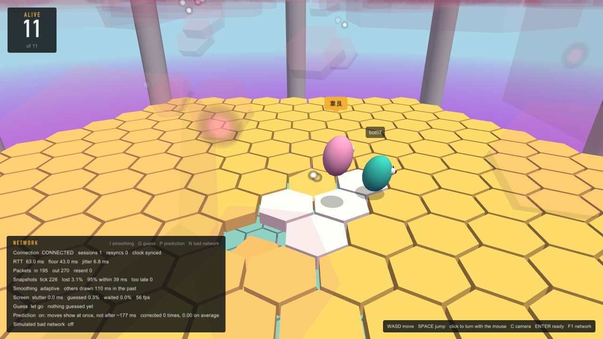

# Desktop client

The desktop client is built in four steps, each playable on its own and each showing one technique for hiding network delay:

| Step | What it adds | What you see |
|---|---|---|
| 1. Draw what arrives | Connect, lobby, draw each snapshot as it comes | It works, but motion stutters (30 snapshots/s on a 60 Hz screen) and your own moves wait a full round trip |
| 2. Interpolation | Remote players are drawn between two snapshots, a little in the past | Smooth remote players; selectable as none, fixed delay or adaptive delay, to show the difference live |
| 3. Prediction and reconciliation | Your own player moves at once; snapshots correct it using `ack_input` | Your own moves feel instant |
| 4. Network overlay | RTT, loss, resends, clock offset, interpolation buffer health; toggles for each technique and for simulated bad networks | The effect of each technique, measured |

## Threads

| | Main thread (raylib) | Network thread |
|---|---|---|
| Owns | window, keyboard, game state, prediction, interpolation, drawing | UDP socket, reliability layer, clock sync, reconnecting |
| Rhythm | 60 frames per second; one input every 33 ms | `poll()` on the socket and a wake-up pipe; at least one packet per 33 ms |
| Never does | touch the socket | call raylib or change game state |

Every piece of data has exactly one thread that writes it. The threads exchange copies through four channels (`client/msg_queue.c`), each guarded by its own mutex:

```
main thread                                         network thread
  inputs, READY, BYE ── outbox (FIFO) ──────────────>  reliability layer → socket
                      ── one byte on the self-pipe ──>  poll() returns at once
  room, board, events <── events (FIFO, never drops) ── reliable messages, in order
  interpolation       <── snapshots (ring of 32) ─────── snapshots, stamped on arrival
  overlay             <── status (copied each loop) ─── RTT, clock offset, counters
```

- **Two kinds of inbound channel, like the two kinds of message.** Reliable messages must not be lost, so they queue in a FIFO. Only recent snapshots matter, so they go into a ring that overwrites the oldest.
- **Packets are timestamped by the network thread** the moment they arrive. Timestamping them when the main thread gets to them would add up to a frame (16 ms) of error to clock sync and interpolation.
- **No lock is held while calling out, and no code holds two locks at once,** so the channels cannot deadlock. `make tsan` runs the queue test and the stress test under ThreadSanitizer.
- **Waking the network thread.** `poll()` watches the socket and the read end of a pipe. `net_send()` queues a message and writes one byte to the pipe, so an input goes out immediately instead of at the next tick. This is the classic self-pipe technique.

## Connection states

Only the network thread changes the state; the main thread reads it from the status copy.

```
CONNECTING --WELCOME--> CONNECTED --4 s without packets--> RECONNECTING --WELCOME--> CONNECTED
                            |
                            +--event queue full--> RESYNCING --queue drained--> RECONNECTING
```

**Resyncing.** If the main thread stops draining events (on macOS, dragging or resizing a window blocks the main thread) and the event queue fills up, a reliable message has nowhere to go. Dropping it would leave the main thread with a wrong board. So the network thread discards everything else from that session, keeps the connection alive meanwhile, waits until the main thread has emptied the queue, and reconnects with its session token. The server hands back the same player and sends WELCOME and the whole board, from which the main thread rebuilds its state. Because the connection stays alive while the main thread is frozen, the server never sees the player disappear.

## Clock synchronisation

The network thread pings the server: five pings 100 ms apart after connecting, then two per second. A PONG returns the client's send time `t0` and the server's time `ts`, and arrives at `t1`:

```
rtt    = t1 - t0
offset = ts - (t0 + rtt / 2)          server time = local time + offset
```

The formula assumes the request and the reply took equally long. Queueing in a busy network or a busy server breaks that assumption for some samples, so the estimate uses the sample with the smallest RTT among the last 16 (Cristian's algorithm with a minimum filter), and once settled the clock moves at most 2 ms per sample so game time never jumps. Both clocks are 32-bit milliseconds that wrap around, so all of this is computed modulo 2^32.

What no NTP-style method can correct is a *constant* asymmetry, where one direction is always slower than the other; the estimate is then off by half the difference. That is why the stress test injects jitter but no constant delay on received packets.

## Step 1: drawing what arrives


The main thread runs one loop per frame, in this order:

1. **Drain the channels.** Every reliable event and every new snapshot is applied to `world` (`client/world.c`), the client's copy of the game built only from server messages. A snapshot older than the newest one already applied is counted as late and skipped. Touched tiles fall when the snapshot's tick passes their moment, so the board's timing follows the server's clock, not the client's.
2. **Read the keyboard.** Inputs are sent at the server's tick rate (30 per second) whatever the frame rate, each packet carrying the last four samples so a lost packet costs nothing. A jump pressed between two input ticks is latched until the next one. W is always "away from the camera", and the camera turns as in a shooter: click into the window and moving the mouse turns it (left and right) and tilts it (up and down) until Esc lets the mouse go; Q/E also turn it. So the keys are turned by the camera's angle before they are sent. The server only ever sees world directions, and prediction (step 3) can replay the same samples whatever the camera did meanwhile.
3. **Draw** (`client/render.c`). The renderer reads the world and the network status and changes neither. Our own bean moves only when a snapshot says so, which is the point of this step: with a 60 Hz screen and 30 snapshots per second every bean visibly steps, and our own moves wait a full round trip. Steps 2 and 3 fix exactly these two things.

What the renderer adds is cosmetic only: the camera follows our bean (C switches to a view of the whole floor), beans turn smoothly and lean when they run, touched tiles shake, a bean that breaks into a sprint kicks up a ring of dust and runs leaning right into it, stretched out, with dust under its feet and the air streaming past (and for our own the lens widens), and falling tiles and knock-outs throw a few particles. Floors above the one being watched fade out. Our own name tag is always shown; of the others, only the four nearest on the same floor (or, while watching, nearest to where the camera looks), so a full room stays readable. Player names may use any script: the font atlas is rebuilt when a name brings characters it does not have yet. The font is found on the system (macOS and common Linux paths) or set with `HEXFALL_FONT`; without one, raylib's built-in font is used.

The network panel (F1) shows the connection state, round-trip time and jitter, clock sync, packet and resend counts, and, from step 2 on, how snapshots arrive and how the screen copes.

## Step 2: interpolation



**The problem.** The server sends a snapshot after every tick, 30 per second. On a real network they do not arrive every 33.3 ms: each spends a different time on the way (jitter), some never arrive (snapshots are never resent), and a late one can arrive after a newer one. Step 1 draws the newest snapshot the moment it arrives, so players freeze while nothing comes and then jump. Even on a perfect network they move in visible steps, because a 60 Hz screen shows each snapshot for two frames.

**The idea.** `client/interp.c` keeps the last 64 snapshots (about 2 s) and draws the game as it was a short time ago, at the *playout* time. Each player is placed between the two snapshots on either side of that moment, so players move smoothly even when snapshots arrive in clumps. A snapshot that arrives out of order still fills its place, as long as the playout has not passed it. This is the jitter buffer of internet voice and video, applied to game state. The price is that everything is drawn a little behind the newest news; step 3 takes that price back for our own player.

**Timing, without clock sync.** The server sends tick `k` at `T0 + k × 33.3 ms` on its own clock. A snapshot that arrives at local time `arrival_k` spent `transit_k` on the way, plus a constant that never matters because only differences are used:

```
transit_k = arrival_k - k × 33.3 ms
late_k    = transit_k - (smallest transit among the last 64)      how much later than the fastest trip
playout   = (now - smallest transit - delay) / 33.3 ms            the tick to draw, fractional
```

Drawing any moment between ticks `k-1` and `k` needs snapshot `k`, so it must arrive before the playout reaches `k-1`: that holds when `late_k ≤ delay - 33.3 ms`. If snapshot `k` is lost, `k+1` has to do instead, which takes one more tick. Arrival times are stamped by the network thread, so a slow frame on the main thread does not count as network jitter.

**Three modes,** switched with I while playing:

| Mode | Delay | |
|---|---|---|
| none | 0 | The newest snapshot as it is (step 1), for comparison |
| fixed | 100 ms | Three ticks, whatever the network does; a common default in shipped games |
| adaptive | 33.3 ms × (1 + lost in a row, at most 2) + `late_k` at the 95th percentile + 5 ms | Goes up at once when the network gets worse, comes down by 20 ms per second when it gets better, so occasional bad seconds do not make it swing |

**The playout clock never jumps.** It runs with real time, and when the delay or the smallest transit changes it runs up to 10% faster or slower until it is where it should be (it only jumps when it is more than 250 ms off, as at the start).

**When a snapshot is late, the screen guesses, then waits.** If the snapshot after the playout time has not arrived, the screen has to show something, and these frames are what a larger delay avoids. It guesses with the game's own physics (`sim_body_step`, the server's code), from the newest snapshot it has and on the board as it was then. What nobody can know is what each player pressed meanwhile. In the air that does not matter: the stick does nothing there, so a jump goes where the bean was heading when it left the floor (turning the camera on the way changes nothing either), and it lands, or falls through a hole, as the board says. On the floor the guess assumes one of three things, switched with G:

| Guess | Players are assumed to | Off by, on average | At most |
|---|---|---|---|
| keep going (default) | hold the stick as they were moving | 0.02 | 0.74 |
| let go | let go of the stick: someone running slides to a stop within a quarter of a second | 0.04 | 0.76 |
| freeze | stand exactly where they were, even in mid-air | 0.26 | 0.93 |

The figures are distances in world units (a bean is 1.8 wide), from the simulated test: a player driven by the physics as a bot plays (running, turning, stopping, jumping), a fixed 100 ms delay, and received packets delayed by 40 to 160 ms with 5% lost, which leaves 292 moments to guess. Each time a snapshot arrives that the screen had to do without, the guess for its moment is compared with what really happened there; the network panel shows the same figure live. Freezing is six to twelve times worse than the physics guesses, because a running bean covers 0.13 units per frame. A jump in progress is certain; the largest errors, for all three, come from jumps that started during the gap, which no guess can see coming.

After 200 ms the screen stops guessing and waits, with a spinner where the connection's notices go: better to stop than to keep making things up. A player who moves more than 4 units per tick between two snapshots has teleported, and is shown jumping, not sliding.

**One moment for the whole scene.** Tiles light up and fall at the playout tick too (each touched tile falls 24 ticks after its touch, which the client works out by itself), and a knock-out notice waits until the playout reaches its tick. Otherwise a tile would vanish from under a bean that, on screen, has not reached it yet.

**Measured.** A server, 10 bots and the client on one machine, 14 s per mode, with received packets delayed by 40 to 160 ms and 5% of them lost (`--inbound 40:120:5`):

| Mode | Drawn behind | Frames guessed | Snapshots that came too late | Stutter |
|---|---|---|---|---|
| none | 0 ms | – | – | 25.2 ms |
| fixed | 100 ms | 14.1% | 125 of 402 | 0.07 ms |
| adaptive | 208 ms | 0.0% | 0 of 398 | 0.46 ms |

*Stutter* is the average, per frame, of how much the moment shown moved differently from real time; on a smooth screen it is 0. With no smoothing it stays high even on a perfect network (15.8 ms in the simulated test), because players move in 33 ms steps. The fixed delay looks smooth by this measure only because guessing keeps players moving; one frame in seven is a guess. With no simulated disturbance the adaptive delay settles at 39 to 41 ms, well under the fixed 100 ms, so it is both smoother on a bad network and more responsive on a good one.

**Trying it.** I cycles none, fixed and adaptive, and G the three guesses (each switch restarts the panel's counters). N cycles the simulated bad network on received packets: off, 20 to 80 ms, and 40 to 160 ms with 5% lost. The network thread applies it (`net_set_inbound`), so one client can see a bad network without changing the server. From the command line: `--interp none|fixed|adaptive`, `--guess keep|let-go|freeze` and `--inbound DELAY:JITTER[:LOSS%]`. On exit the client logs the figures, as in the tables above.

## Step 3: prediction and reconciliation



**The problem.** Since step 2 every player is drawn a little in the past. For other players nobody can tell. For our own player everybody can: a key press travels to the server, waits its turn in the server's input queue, comes back in a snapshot, and then waits in the jitter buffer. With a 60 ms round trip that came to about 180 ms from pressing a key to seeing the bean move, and it feels like steering a boat.

**The idea.** The client has the same physics as the server (`common/sim.c`) and knows its own inputs, so it can work out where the server is going to put it before the server does. `client/predict.c` moves our bean with each input as it is sent. The server stays in charge: every snapshot says where it really put us, and with which of our inputs (`ack_input`). The client starts again from there and replays the inputs the server has not used yet. That is reconciliation. When both ran the same physics on the same inputs, the replay lands exactly where the prediction already was and nothing shows. When they did not, the bean is pulled to the right place over about 100 ms instead of jumping there.

**Timing.** The server uses one input per tick, in order; the rules are in `common/input_queue.c`, shared by the server and the client so both turn an input into motion the same way. If the newest snapshot is of tick `T` and has used our inputs up to `A`, input `A + k` will be used at tick `T + k`, so after our newest input `L` our bean is at tick `T + (L - A)`. That is our bean's "present": `L - A` ticks ahead of the newest snapshot, and further still ahead of the moment the others are drawn at. Between two input ticks the bean is drawn part of the way to the next step, worked out with the keys as they are at that frame, so a key press shows on the very next frame. The jump cooldown is not in a snapshot; it comes from our own prediction for input `A`.

**Bumping into others.** The server pushes players apart when they meet (`sim_separate`), and bumping is half the game. For a bump to happen on screen the moment it happens, and for the prediction to agree with the server about it, the others have to be predicted too. So from the newest snapshot the client plays the server's ticks for everybody up to our present: our inputs for us; for the others, the stick held as they were moving (the same guess as in step 2); then everybody pushed apart, in the server's order. That gives each of the others two moments: the playout past, where every position is real, and our present, which is partly a guess. Far from our bean the past is drawn, as in step 2. Within 6 units the present is drawn, so what our bean bumps into is where it is drawn; between 6 and 10 units, a mix, so a bean coming closer slides from one to the other. When a snapshot shows that a guess about someone was wrong, the change is smoothed out like our own corrections.

When two beans meet on screen, both flash, squash and wobble back into shape and are knocked back the way they were pushed, and stars and a shock ring fly where they touched; if one of them is ours, the camera jolts, the lens punches wider and a word pops up (BONK!). All of it grows with how fast the two were closing in: a brush in passing is a nudge, running head-on into someone the most. This is judged from where the beans are drawn, so it happens where the player sees them touch.

**Tiles live in two moments too.** Drawn at the playout moment, a tile would light up only after we had left it, and could still be drawn while our bean falls through it. So the tiles our bean has been on, and the tiles near it, are drawn at our present moment: they light up as soon as we step on them, before the server says so, and fall when the server says they fall, never on our word alone. If the server has not agreed within 20 ticks that we touched a tile, it goes back to how the server sees it. Tiles far away are drawn at the playout moment, with the players on them. Our own knock-out notice also follows our moment.

**What still gets corrected.** Things the client cannot know:

- **An input that came too late.** If none of ours is waiting when a tick comes, the server uses the old stick once more; if a burst arrives after a stall, it skips some. Either way the bean's path differs by up to one tick of movement, and if that happens as we jump, for the whole jump, since nothing steers in the air.
- **Others changing what they do.** A bump with someone who turned, stopped or jumped since the newest snapshot is predicted against where they would have been.
- **Rounding.** Positions travel in hundredths of a unit, so in principle one bean can be just over the edge of a hole and the other not. Since the stick does nothing in the air, this no longer shows up in the tests.

**Measured** in the simulated test (rounds of 10 s, a player running, turning, jumping and falling through floors as a bot plays):

| Network | Snapshots | Corrections | Average | Largest | Largest move in one frame |
|---|---|---|---|---|---|
| perfect, 50 ms round trip | 1437 | 0 | – | – | 0.17 |
| 30 to 90 ms each way, 5% lost | 1844 | 10 | 0.17 | 0.33 | 0.18 |

A running bean moves 0.13 per frame and a sprinting one 0.18, so even the corrections never show as a jump. Bumps, on the perfect network, with another player holding its stick one way:

| Bump | Largest correction | Without predicting the others |
|---|---|---|
| running into a player standing still, and pushing it along | 0.06 | 0.27, every snapshot while pushing |
| head-on into a player running at us | 0.06 | 0.72 |

A shove the client cannot know about at all, 1.5 units, is corrected as a quick slide. Live, against a server that delays its packets by 40 to 80 ms (a 63 ms round trip), the panel estimated that without prediction our moves would show after 177 to 207 ms.

**At the start and the end of a round.** The first snapshot of a round still carries the ack of an input from before the round, which the server never used for this round; predicting from it would replay seconds of lobby keys. Prediction starts with the first snapshot whose ack is less than 30 inputs old. For the first 2 s the floor holds (the server says until which tick); the prediction lights no tile before then, and the screen counts it down. When the round ends, the server stops moving everybody; our bean glides to where the server stopped it.

**Trying it.** P turns prediction on and off while playing; the panel's prediction line says how long a key press takes to show without it. From the command line: `--predict on|off`. `--autopilot` presses keys as a bot would, for unattended checks.

## Testing

- `tests/test_world.c`: the client's game state fed the messages a server would send, including a late snapshot, a tile that falls on time, a knock-out, and a second WELCOME after a resync.
- `tests/test_interp.c`: interpolation against a simulated server, network and 60 Hz screen, with simulated time so the result does not depend on the machine. On a perfect network the fixed delay is exactly three ticks with no guessing, the adaptive one just over one tick, and no smoothing stutters. On a bad network (40 to 160 ms, 5% lost) the fixed delay guesses in more than 10% of frames and the adaptive one in under 3%. In every frame that is not a guess the player is drawn exactly where it was at the moment shown. The three guesses are scored on a player driven by the physics; both physics guesses must beat freezing. Also: after a one-second outage the screen waits and then carries on, the adaptive delay comes down slowly once the network recovers, a teleport is not slid across, a server restart starts the history over, and tiles are shown as they were at a given moment.
- `tests/test_predict.c`: prediction against a server of the test's own (the same input queue and physics as the real one, tiles that fall, snapshots encoded and decoded as on the wire) and a network in each direction, in steps of 1 ms of simulated time. A key press shows on the next frame; on a perfect network nothing but rounding is ever corrected; on a bad network the bean never jumps on screen; running into another player, and head-on into one, is foreseen; a shove is corrected smoothly; tiles under our bean are lit at once and drawn gone on the frame our bean starts to fall; while the floor holds at the start of a round, no tile is lit, and from the tick it gives way, the one underfoot is; and the stale ack at the start of a round is not predicted from.
- `tests/test_msg_queue.c`: a producer and a consumer thread move 300,000 messages through the FIFO (with capacity 1 and 64) and the ring; nothing is lost, duplicated or reordered.
- `tests/test_clock_sync.c`: lopsided simulated round trips across a 32-bit wrap-around; the estimate stays within 3 ms.
- `tests/stress_net.sh` (`make stress`): a server, bots, and 16 probes, each with its own network thread, which freeze for 4 seconds every round with a 48-message event queue while 5% of received packets are lost and the rest jittered. The probes check that every probe ends up connected, reliable events never arrive out of order or before the board, every stall led to a resync, and all clock offsets agree.
- `make tsan` runs the queue test and the stress test under ThreadSanitizer. On Linux kernels with high address-space randomisation ThreadSanitizer may refuse to start ("unexpected memory mapping"); run it as `setarch $(uname -m) -R make tsan`, which disables randomisation for that command only.

## What the stress test found

Two bugs that unit tests did not catch, both now covered by the stress test:

- **Lopsided round trips skewed the clock by 10 ms or more.** Both the client's PING and the server's PONG waited for the next 33 ms tick before being sent, adding up to 33 ms to one direction or the other. Clock sync assumes both directions take equally long, so the estimates spread from -14 to +10 ms. Both sides now send them immediately; on one machine all 16 probes agree within 3 ms of the true offset, and the minimum round trip dropped from about 20 ms to under 2 ms.
- **Packets from an old connection corrupted the new one.** After a reconnect, packets held back from the old socket (by the fault injection, or by a real network) were fed to the new connection. Their sequence numbers made it discard genuine packets as old, and their acknowledgements told the server that messages had arrived when they had not. A lost reliable message then stalled every later one, while snapshots kept flowing, so the client looked connected but never saw the lobby again. Every connection now gets a fresh session token, so the server drops anything still in flight from the old one, and the client discards packets held for a closed socket.

## Files

| File | Contents |
|---|---|
| `client/net_client.[ch]` | UDP connection core, single-threaded; also used by the bots |
| `client/msg_queue.[ch]` | The FIFO and ring channels |
| `client/net_thread.[ch]` | The network thread and the API the main thread uses |
| `client/clock_sync.[ch]` | Clock synchronisation, pure functions |
| `client/netprobe.c` | Headless stand-in for the main thread; the stress test |
| `client/world.[ch]` | The client's game state, built only from server messages |
| `client/interp.[ch]` | Snapshot interpolation: the history, the playout clock, the three modes, guessing |
| `client/predict.[ch]` | Prediction and reconciliation of our own player; which moment each tile is drawn at |
| `client/render.[ch]` | Drawing with raylib: scene, camera, HUD, network panel |
| `client/game.c` | The desktop client's main loop: channels, keyboard and mouse, inputs, drawing |
| `common/input_queue.[ch]` | The server's input queue, shared so the client predicts with the same rules |
