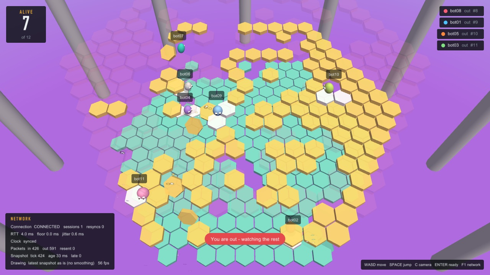

# Desktop client

The desktop client is built in four steps, each playable on its own and each showing one technique for hiding network delay:

| Step | What it adds | What you see |
|---|---|---|
| 1. Draw what arrives | Connect, lobby, draw each snapshot as it comes | It works, but motion stutters (30 snapshots/s on a 60 Hz screen) and your own moves wait a full round trip |
| 2. Interpolation | Remote players are drawn between two snapshots, a little in the past | Smooth remote players; selectable as none, fixed delay or adaptive delay, to show the difference live |
| 3. Prediction and reconciliation | Your own player moves at once; snapshots correct it using `ack_input` | Your own moves feel instant |
| 4. Network overlay | RTT, loss, resends, clock offset, interpolation buffer health; toggles for each technique and for simulated bad networks | The effect of each technique, measured |

## Threads

| | Main thread (raylib) | Network thread |
|---|---|---|
| Owns | window, keyboard, game state, prediction, interpolation, drawing | UDP socket, reliability layer, clock sync, reconnecting |
| Rhythm | 60 frames per second; one input every 33 ms | `poll()` on the socket and a wake-up pipe; at least one packet per 33 ms |
| Never does | touch the socket | call raylib or change game state |

Every piece of data has exactly one thread that writes it. The threads exchange copies through four channels (`client/msg_queue.c`), each guarded by its own mutex:

```
main thread                                         network thread
  inputs, READY, BYE ── outbox (FIFO) ──────────────>  reliability layer → socket
                      ── one byte on the self-pipe ──>  poll() returns at once
  room, board, events <── events (FIFO, never drops) ── reliable messages, in order
  interpolation       <── snapshots (ring of 32) ─────── snapshots, stamped on arrival
  overlay             <── status (copied each loop) ─── RTT, clock offset, counters
```

- **Two kinds of inbound channel, like the two kinds of message.** Reliable messages must not be lost, so they queue in a FIFO. Only recent snapshots matter, so they go into a ring that overwrites the oldest.
- **Packets are timestamped by the network thread** the moment they arrive. Timestamping them when the main thread gets to them would add up to a frame (16 ms) of error to clock sync and interpolation.
- **No lock is held while calling out, and no code holds two locks at once,** so the channels cannot deadlock. `make tsan` runs the queue test and the stress test under ThreadSanitizer.
- **Waking the network thread.** `poll()` watches the socket and the read end of a pipe. `net_send()` queues a message and writes one byte to the pipe, so an input goes out immediately instead of at the next tick. This is the classic self-pipe technique.

## Connection states

Only the network thread changes the state; the main thread reads it from the status copy.

```
CONNECTING --WELCOME--> CONNECTED --4 s without packets--> RECONNECTING --WELCOME--> CONNECTED
                            |
                            +--event queue full--> RESYNCING --queue drained--> RECONNECTING
```

**Resyncing.** If the main thread stops draining events (on macOS, dragging or resizing a window blocks the main thread) and the event queue fills up, a reliable message has nowhere to go. Dropping it would leave the main thread with a wrong board. So the network thread discards everything else from that session, keeps the connection alive meanwhile, waits until the main thread has emptied the queue, and reconnects with its session token. The server hands back the same player and sends WELCOME and the whole board, from which the main thread rebuilds its state. Because the connection stays alive while the main thread is frozen, the server never sees the player disappear.

## Clock synchronisation

The network thread pings the server: five pings 100 ms apart after connecting, then two per second. A PONG returns the client's send time `t0` and the server's time `ts`, and arrives at `t1`:

```
rtt    = t1 - t0
offset = ts - (t0 + rtt / 2)          server time = local time + offset
```

The formula assumes the request and the reply took equally long. Queueing in a busy network or a busy server breaks that assumption for some samples, so the estimate uses the sample with the smallest RTT among the last 16 (Cristian's algorithm with a minimum filter), and once settled the clock moves at most 2 ms per sample so game time never jumps. Both clocks are 32-bit milliseconds that wrap around, so all of this is computed modulo 2^32.

What no NTP-style method can correct is a *constant* asymmetry, where one direction is always slower than the other; the estimate is then off by half the difference. That is why the stress test injects jitter but no constant delay on received packets.

## Step 1: drawing what arrives



The main thread runs one loop per frame, in this order:

1. **Drain the channels.** Every reliable event and every new snapshot is applied to `world` (`client/world.c`), the client's copy of the game built only from server messages. A snapshot older than the newest one already applied is counted as late and skipped. Touched tiles fall when the snapshot's tick passes their moment, so the board's timing follows the server's clock, not the client's.
2. **Read the keyboard.** Inputs are sent at the server's tick rate (30 per second) whatever the frame rate, each packet carrying the last four samples so a lost packet costs nothing. A jump pressed between two input ticks is latched until the next one. The camera always faces the same way, so W is always "away from the camera" and needs no conversion.
3. **Draw** (`client/render.c`). The renderer reads the world and the network status and changes neither. Our own bean moves only when a snapshot says so, which is the point of this step: with a 60 Hz screen and 30 snapshots per second every bean visibly steps, and our own moves wait a full round trip. Steps 2 and 3 fix exactly these two things.

What the renderer adds is cosmetic only: the camera follows our bean (C switches to a view of the whole floor), beans turn smoothly and lean when they run, touched tiles shake, and falling tiles and knock-outs throw a few particles. Floors above the one being watched fade out. Player names may use any script: the font atlas is rebuilt when a name brings characters it does not have yet. The font is found on the system (macOS and common Linux paths) or set with `HEXFALL_FONT`; without one, raylib's built-in font is used.

The network panel (F1) shows the connection state, round-trip time and jitter, clock sync, packet and resend counts, and the age of the snapshot on screen.

## Testing

- `tests/test_world.c`: the client's game state fed the messages a server would send, including a late snapshot, a tile that falls on time, a knock-out, and a second WELCOME after a resync.
- `tests/test_msg_queue.c`: a producer and a consumer thread move 300,000 messages through the FIFO (with capacity 1 and 64) and the ring; nothing is lost, duplicated or reordered.
- `tests/test_clock_sync.c`: lopsided simulated round trips across a 32-bit wrap-around; the estimate stays within 3 ms.
- `tests/stress_net.sh` (`make stress`): a server, bots, and 16 probes, each with its own network thread, which freeze for 4 seconds every round with a 48-message event queue while 5% of received packets are lost and the rest jittered. The probes check that every probe ends up connected, reliable events never arrive out of order or before the board, every stall led to a resync, and all clock offsets agree.
- `make tsan` runs the queue test and the stress test under ThreadSanitizer. On Linux kernels with high address-space randomisation ThreadSanitizer may refuse to start ("unexpected memory mapping"); run it as `setarch $(uname -m) -R make tsan`, which disables randomisation for that command only.

## What the stress test found

Two bugs that unit tests did not catch, both now covered by the stress test:

- **Lopsided round trips skewed the clock by 10 ms or more.** Both the client's PING and the server's PONG waited for the next 33 ms tick before being sent, adding up to 33 ms to one direction or the other. Clock sync assumes both directions take equally long, so the estimates spread from -14 to +10 ms. Both sides now send them immediately; on one machine all 16 probes agree within 3 ms of the true offset, and the minimum round trip dropped from about 20 ms to under 2 ms.
- **Packets from an old connection corrupted the new one.** After a reconnect, packets held back from the old socket (by the fault injection, or by a real network) were fed to the new connection. Their sequence numbers made it discard genuine packets as old, and their acknowledgements told the server that messages had arrived when they had not. A lost reliable message then stalled every later one, while snapshots kept flowing, so the client looked connected but never saw the lobby again. Every connection now gets a fresh session token, so the server drops anything still in flight from the old one, and the client discards packets held for a closed socket.

## Files

| File | Contents |
|---|---|
| `client/net_client.[ch]` | UDP connection core, single-threaded; also used by the bots |
| `client/msg_queue.[ch]` | The FIFO and ring channels |
| `client/net_thread.[ch]` | The network thread and the API the main thread uses |
| `client/clock_sync.[ch]` | Clock synchronisation, pure functions |
| `client/netprobe.c` | Headless stand-in for the main thread; the stress test |
| `client/world.[ch]` | The client's game state, built only from server messages |
| `client/render.[ch]` | Drawing with raylib: scene, camera, HUD, network panel |
| `client/game.c` | The desktop client's main loop: channels, keyboard, inputs, drawing |
